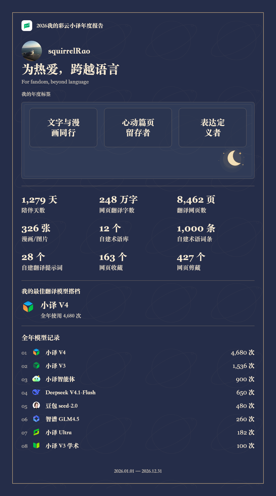

# 彩云小译 2026 年度活动 Demo

为热爱，跨越语言  
For fandom, beyond language

当前 V20 交互原型，用于年度活动策划评审。网页为单文件静态实现，素材已内嵌，无需数据库、后端或网络字体。

## 查看

[暖光星空版](https://squirrelrao.github.io/lingocloud-2026-annual-demo/) · [水墨纸书版](https://squirrelrao.github.io/lingocloud-2026-annual-demo/ink.html)

也可下载本仓库并直接打开 `index.html`。

支持网页模式，以及 iOS、Android、鸿蒙的 APP 页面预览。APP 预览可用 `?preview=app&platform=ios`（或 android、harmony）进入。

## 当前内容

- 00 数据使用同意封面，01 相伴与年度翻译足迹，02 网页，03 漫画/图片，04 模型，05 术语，06 收藏剪藏，07 年度标签，08 年度总览
- 九项已确认数据；注册以来陪伴和2026年度翻译用量分组显示
- 按数据自动匹配三个并列年度标签，没有选择或留白
- 九个模型的官方图标、使用次数与最佳翻译模型搭档
- 暖纸、星空与暮色主题，以及各页独立光影彩蛋
- 完整年度 PNG 生成、双击缩略图在全窗口查看、底部年度日期居中

全部使用内嵌模拟数据。昵称与头像为 Demo 样例；发布此网页不会读取访问者真实账号或统计。真实 AI、统计授权和原生相册需由 APP 宿主另行接入；浏览器保存使用下载，不能视为已写入手机相册。

## 启用 GitHub Pages

在仓库 **Settings → Pages → Build and deployment** 中，Source 选择 **Deploy from a branch**，Branch 选择 **master**，文件夹选择 **/ (root)**，保存。部署成功后使用页面返回的 URL。

根目录含 `.nojekyll`，可作为普通静态网页发布。更新 `index.html` 后提交到 master，Pages 会重新部署。

## 编辑与检查

`index.html` 是可直接发布的完整网页；`source/` 提供拆分后的 HTML、CSS 和 JS，备份素材位于 `brand/`、`profile/`、`models/`。

```sh
python3 scripts/build_demo.py --project .
node tests/verify.mjs
node tests/verify-integration.mjs
```

Node 使用支持现代 JavaScript 的版本。两组检查覆盖数据、模型、自动标签、授权、APP 状态、PNG 与全窗口大图交互；它们使用模拟 DOM/Canvas，不代表真实浏览器、WebView、手机触控或原生相册端到端验收。

陪伴数据固定截至2026-10-22，模型目录快照2026-10-23；不因浏览日期改变模拟数据。

## 年度卡示例



## 水墨纸书版本

顶部「水墨纸书」入口切换。完整报告引擎共用；独立纸面封装、山水书封、书册目录、装订与纸张层次、前后翻页动效。支持按钮、方向键与触屏横划；减少动态效果时静态切页。年度卡采用墨色纸面并保持同图预览／保存。source/ink.css、ink.js是独立表现层，source/editions.js负责跨风格有效状态传递；构建脚本同时生成index.html和ink.html。新增检查：node tests/verify-ink.mjs。

仿真翻页使用移动斜折线、纸面裁切和镜像纸背，配合低透明透墨、曲面卷边明暗及投影；前进翻起、后退展开，持续约1秒。几何检查：node tests/verify-paper-fold.mjs。
